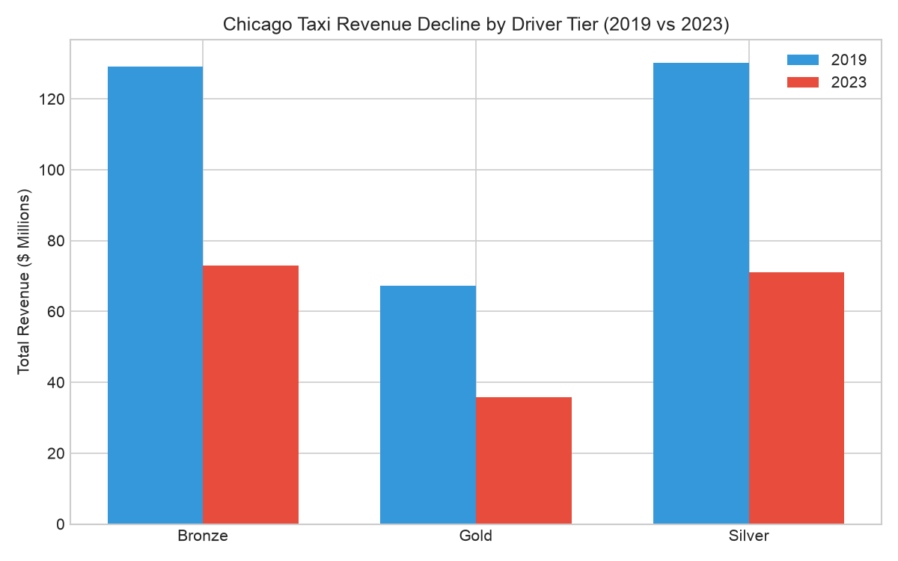
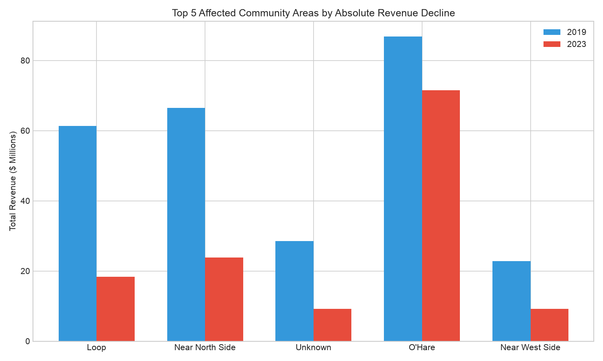
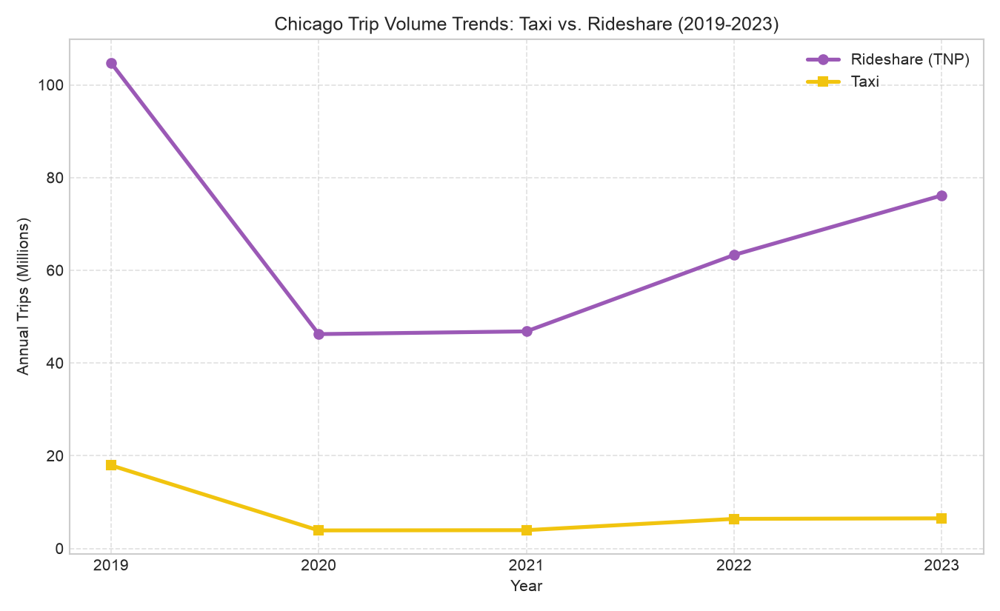
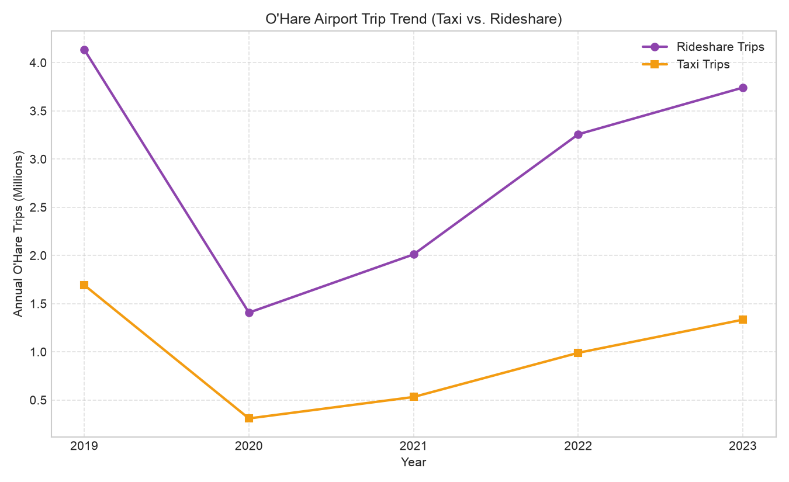

# Chicago Taxi Revenue Decline Investigation (2019-2023)

## 1. Executive Summary
Between 2019 and 2023, Chicago taxi revenue experienced a severe decline, dropping by **45.0%** from **$326.7M** to **$179.9M**. This decline was primarily driven by intense rideshare (TNP) competition, which captured a significant share of the market, particularly in downtown corridors. Every driver tier (Bronze, Silver, Gold) and all major geographic zones saw significant drops in revenue.

## 2. Root Cause Finding
The primary root cause of the taxi revenue decline is **intense rideshare competition (TNP)** rather than weather conditions or fleet downsizing alone. 
- In 2019, taxis had **14.6%** of the combined taxi/rideshare trip market in Chicago. By 2023, taxi market share collapsed to just **7.9%**, while rideshare volumes recovered and dominated the post-pandemic landscape.
- Annual weather patterns at O'Hare airport showed no significant correlation with the long-term, multi-year decline. The driest/warmest years (e.g., 2023) and the snowiest years (e.g., 2021) did not disrupt the steady downward trend in taxi revenue, ruling out weather as a primary driver.

## 3. Affected Segments

### 3.1 Driver Tiers Most Affected
All driver tiers experienced severe revenue declines, but **Bronze** and **Silver** drivers took the largest absolute hit, while **Gold** drivers saw the steepest relative decline in terms of average revenue per active driver:

| Driver Tier | 2019 Active Drivers | 2023 Active Drivers | Driver Count Change (%) | 2019 Total Rev ($M) | 2023 Total Rev ($M) | Revenue Change (%) | 2019 Rev per Driver ($) | 2023 Rev per Driver ($) | Rev/Driver Change (%) |
| :--- | :---: | :---: | :---: | :---: | :---: | :---: | :---: | :---: | :---: |
| **Bronze** | 2215 | 1391 | -37.2% | $129.21M | $72.94M | -43.6% | $58335 | $52435 | -10.1% |
| **Silver** | 2277 | 1339 | -41.2% | $130.19M | $71.05M | -45.4% | $57175 | $53063 | -7.2% |
| **Gold** | 1106 | 675 | -39.0% | $67.33M | $35.87M | -46.7% | $60875 | $53136 | -12.7% |

Key Findings:
- **Silver Tier** suffered the largest total revenue loss (**$59.1M** decline), just ahead of Bronze (**$56.3M**).
- **Gold Tier** had the steepest drop in average revenue per driver (**12.7%**), and its active driver count shrunk by **39.0%** (from 1106 to 675). Silver lost the largest share of its active drivers (**41.2%**).

### 3.2 Geographic Zones Most Affected
Geographically, the decline was concentrated in the downtown core.

**Top 5 Zones by Absolute Revenue Loss:**
1. **Loop (Zone 32):** Lost **$43.1M** (declined from $61.4M to $18.3M, **-70.2%**)
2. **Near North Side (Zone 8):** Lost **$42.7M** (declined from $66.5M to $23.8M, **-64.2%**)
3. **Unknown (no community area):** Lost **$19.3M** (declined from $28.5M to $9.2M, **-67.8%**)
4. **O'Hare (Zone 76):** Lost **$15.3M** (declined from $86.8M to $71.5M, **-17.6%**)
5. **Near West Side (Zone 28):** Lost **$13.6M** (declined from $22.8M to $9.2M, **-59.6%**)

*Note: Loop and Near North Side saw the largest absolute revenue reductions. O'Hare lost less in percentage terms (-17.6%), so airport taxi demand held up better than downtown.*

## 4. Supporting Evidence

- **Market Share Shift**: In 2019, Chicago saw **104.8M** rideshare trips vs **17.9M** taxi trips. In 2023, rideshare volume stayed high at **76.1M** while taxi trips fell to **6.5M**.
- **Airport Competition**: At O'Hare (Zone 76), taxi trips fell from **1.69M** in 2019 to **1.33M** in 2023, while rideshare trips reached **3.74M**.

## 5. Charts
- **Revenue decline by Driver Tier**: 
- **Top Affected Zones**: 
- **Taxi vs Rideshare Trips Trend**: 
- **O'Hare Airport specific trend**: 

## 6. Caveats
- Driver profiles in Cloud SQL were joined to BigQuery trips using the `taxi_id` field. We assumed that drivers remained in the same tier and operated the same vehicle type between 2019 and 2023, as historical driver tier snapshots were not available in the database.
- A small number of trips (less than 1%) had missing community area IDs or invalid `taxi_id` values, which were excluded from the analysis.
